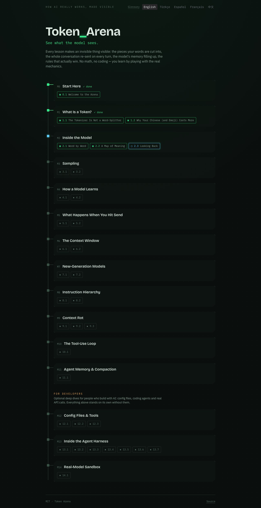
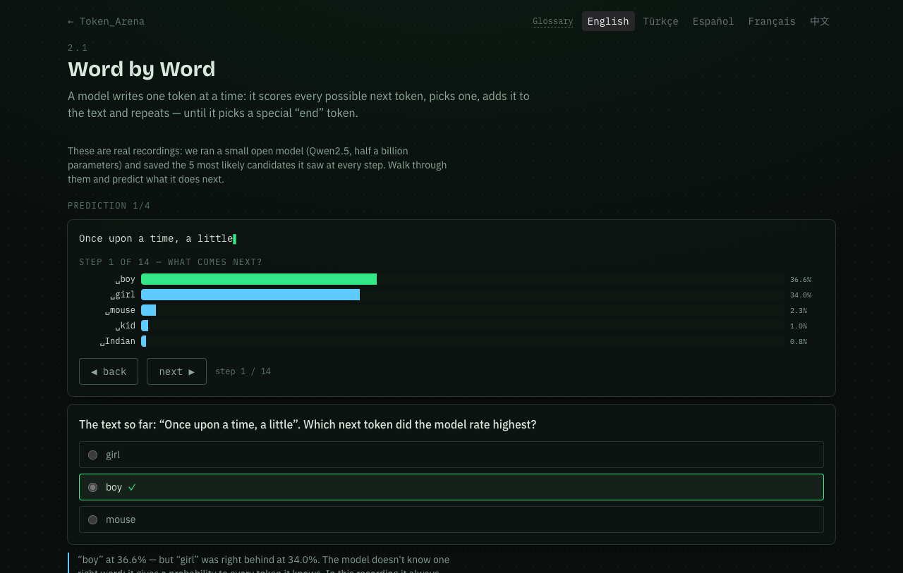
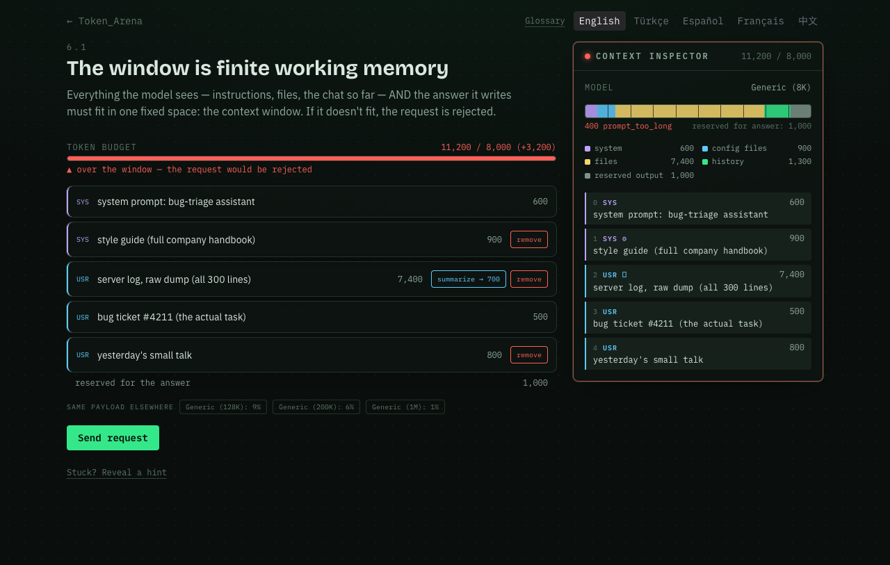
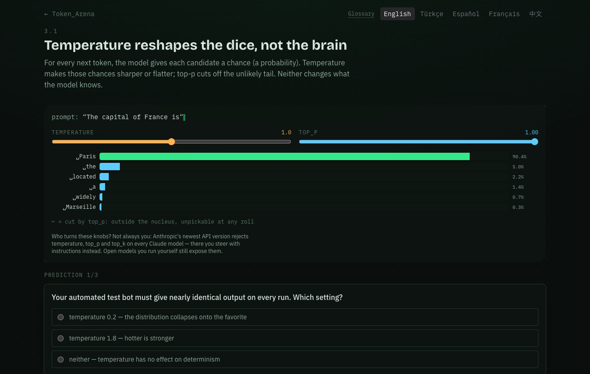

# Token Arena

**See what the model sees.** A free, open-source, fully static web game that shows anyone how the AI behind ChatGPT, Claude and Gemini actually works — no math or coding needed. Tokens, how a model writes word by word, meaning maps, attention, training and hallucinations, sampling, the stateless request loop, the context window, thinking models, image tokens, instruction hierarchy, context rot, tools and agents — and, in an optional section for developers, config files and the coding-agent harness. Real mechanics under a game, in the spirit of [Oh My Git!](https://ohmygit.org).

**Play it:** https://thornaci.github.io/token-arena — English, Turkish, Spanish, French and Chinese, no backend, no accounts, no telemetry. Progress lives in your browser.



## What's inside

- **15 modules, 34 lessons** — from "what is a token" to a real-API capstone. Scripted lessons are deterministic, and data tests check their numbers against the engines, the recordings, or the published formulas they come from.
- **Recorded real models** — the "Inside the Model", "How a Model Learns" and "New-Generation Models" modules replay real runs of small open models (Qwen2.5-0.5B base and instruct, Qwen3-0.6B with thinking on and off, EmbeddingGemma for the meaning map). No model downloads to the player; all recordings together are under 70 KB of JSON.
- **The Context Inspector** — the signature panel. It shows the exact payload the model would receive on the next turn: every block, every token count, the fill bar, the simulated `400: prompt too long`.
- **A live model in your browser** — the sampling module can run Qwen2.5-0.5B-Instruct via [transformers.js](https://github.com/huggingface/transformers.js) on WebGPU after a size-consented download. No WebGPU? It replays a recorded run of the same model with the identical UI.
- **Image tokens** — a calculator that follows Anthropic's published resize-and-patch rule, so the token counts are the real ones.
- **For developers (optional)** — config files (CLAUDE.md, AGENTS.md, Cursor rules), what a coding-agent session loads before you type, skills, MCP, subagents, hooks, permission modes, what survives `/compact`, and a bring-your-own-key sandbox that sends real requests straight from your browser.
- **Glossary, badges and tiered hints** — a plain-language glossary page; progress lives in your browser's local storage.

| How a model writes, recorded | The window filling up | Real sampling math |
| --- | --- | --- |
|  |  |  |

## Quickstart

```sh
npm ci
npm run dev      # compiles i18n, starts the dev server
npm test         # unit + data-reality tests
npm run build    # static production build (GitHub Pages ready)
npm run preview  # preview the production build
```

Requires Node ≥ 22 (the optional recording script needs Node ≥ 23).

## Architecture in seven lines

- **Astro 7** static site (base `/token-arena`), **React 19** islands for the interactive parts, **Tailwind 4** design tokens.
- **Lessons are data, not code**: JSON in `src/content/lessons/**`, validated by a zod schema that also checks every referenced i18n key exists and that pass criteria line up with the authored content.
- **Mechanics are components**: `src/components/mechanics/*` registered in `src/components/sim/registry.ts`; a new lesson usually needs zero new code.
- **Engines are pure TypeScript**: tokenizer wrapper, context/billing/sampling/scoring/sim-step machines, replay, embedding-map and image-token math in `src/engine/` — all unit-tested in Node.
- **Determinism rule**: scripted lessons use authored `fixedTokens` only; live tokenization exists only in playground surfaces. Data tests recompute authored answers against the real engines.
- **Recordings**: `node scripts/record.mjs <lesson id…|all>` runs the models a lesson names and writes `public/prerecorded/*.json`; tests fail if a recording drifts from its lesson.
- **i18n**: flat catalogs in `messages/{en,tr,es,fr,zh}.json` via Paraglide; CI fails if locales drift apart.

## Contributing

New lessons, new locales, and new mechanics are all designed to arrive as PRs — see [CONTRIBUTING.md](CONTRIBUTING.md) for the full walkthrough (including the schema reference and the "add a lesson without writing code" path).

## License

[MIT](LICENSE)
